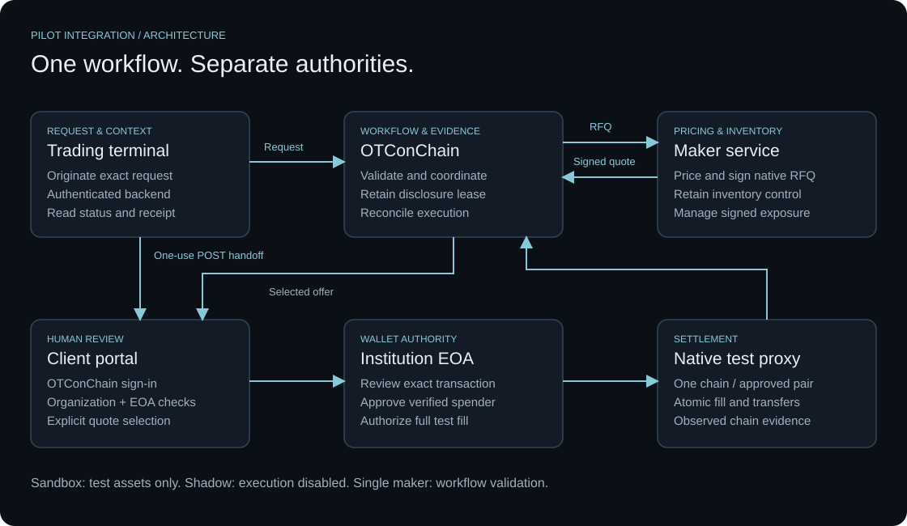
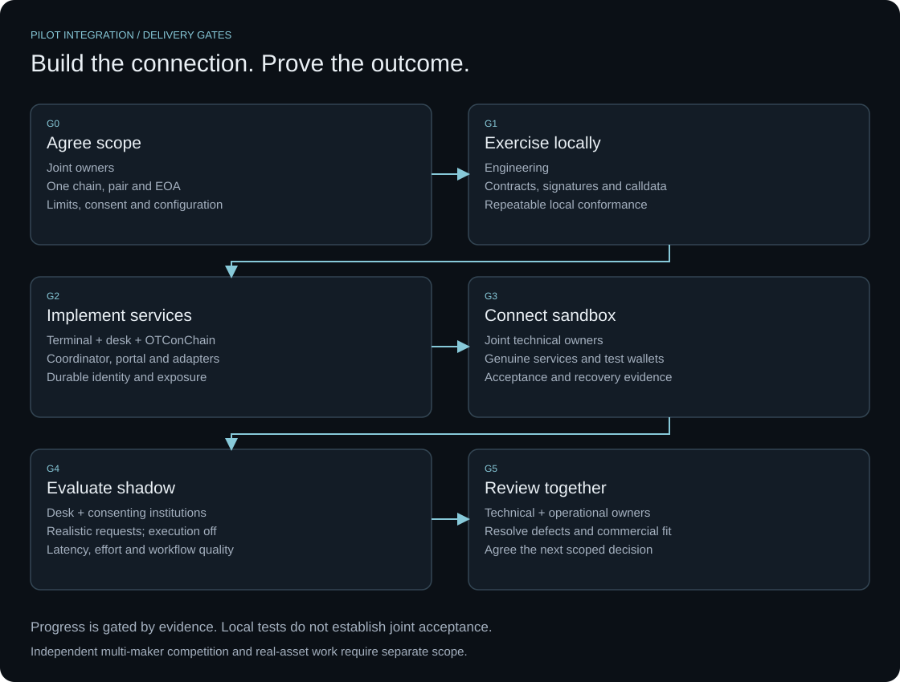
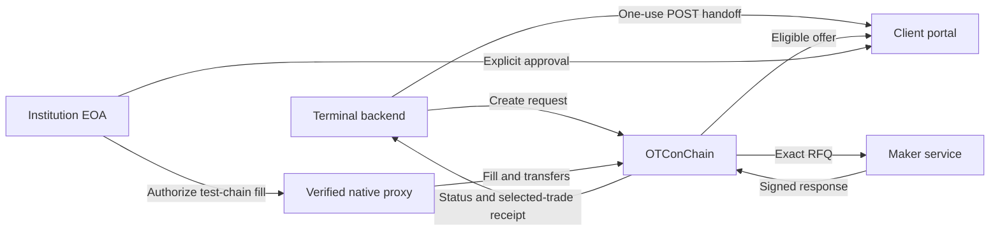

# OTConChain · Pilot Integration

**From a terminal request to a client-approved RFQ and a reconciled on-chain record.**

A practical integration roadmap for a trading terminal, its liquidity desk and an institutional client. Start with one maker, one approved ERC-20 pair and one EVM test chain.

[Start here](#start-here) · [Roadmap](docs/08-delivery-roadmap.md) · [API contracts](#contracts-and-examples) · [Run locally](#run-locally) · [Acceptance](docs/09-connection-and-acceptance.md)



## What the pilot proves

A real terminal request reaches a real maker sandbox, the client reviews the offer through an authenticated portal, and both sides can retrieve the same versioned outcome. Sandbox settlement uses test assets; shadow evaluation disables execution.

**Status: proposal for joint implementation.** The schemas, fixtures, client scaffold and maker emulator are available. The hosted coordinator, client portal, terminal connector and genuine desk connection still need implementation and joint acceptance. One maker validates the workflow; an independent multi-maker phase is a later gate.

## Start here

| If you are… | Read first | Leave with… |
| --- | --- | --- |
| CTO / integration lead | [Scope](docs/01-pilot-scope.md) → [Roadmap](docs/08-delivery-roadmap.md) | Owners, work packages and decisions needed at kickoff |
| Terminal engineer | [Authority](docs/02-architecture-and-authority.md) → [Partner API](docs/03-partner-api.md) | Request, handoff, polling and recovery contract |
| Maker engineer | [Maker API](docs/04-maker-api.md) → [Settlement](docs/05-settlement.md) | Exact native types, signer/inventory checks and full-fill policy |
| Client / operations lead | [Lifecycle](docs/06-lifecycle-and-recovery.md) → [Acceptance](docs/09-connection-and-acceptance.md) | Approval, stop/recovery behavior and connection-day evidence |

## Integration roadmap



Each gate needs its own evidence. Local tests do not mark the joint pilot accepted. See the [work packages and exit criteria](docs/08-delivery-roadmap.md).

## How a request moves



The terminal credential can create requests and read authorized outcomes. Selection and wallet authorization stay with the institution in the portal. The maker retains signing and inventory authority. See the [complete sequence](docs/02-architecture-and-authority.md#first-integration-authenticated-handoff).

## Contracts and examples

| Material | Version | Purpose |
| --- | --- | --- |
| [Partner OpenAPI](contracts/partner.openapi.json) | 0.1.0-draft | Terminal → OTConChain; seven request/handoff/status operations |
| [Maker OpenAPI](contracts/maker-adapter.openapi.json) | 1.0.0-draft | OTConChain → maker; exact RFQ → firm / indicative / declined |
| [Partner fixtures](examples/partner.json) | 0.1.0-draft | Linked request, handoff, events and receipt examples |
| [Signed maker fixtures](examples/maker.json) | 1.0.0-draft | Native EIP-712 teaching order and disposable signature |
| [Pilot environment](config/pilot-environment.example.json) | Unagreed template | URLs, public wallet addresses, policy and approval owners |
| [Acceptance matrix](acceptance/matrix.json) | 26 unrun cases | Expected results, evidence, defect owner and reviewer |

Fixtures use mock addresses and historical deadlines. Public schemas are proposals, not discoverable live endpoints. Keep agreed configurations and real evidence in a private workspace; publish only redacted examples.

## Run locally

Use Node.js 22+ and npm. From a clean checkout:

```sh
npm ci
npm test
npm run client:dry-run
```

The client dry run prints a fixture request with zero network calls. The tests validate contracts/fixtures, documentation links, native signatures, calldata and local maker behavior. To start the loopback-only maker emulator:

```sh
LOCAL_MAKER_TOKEN=local-test-only npm run maker:start
```

It listens at `127.0.0.1:4190` and uses an unfunded disposable signer. It does not supply the coordinator or portal. Read the [maker-kit guide](maker-kit/README.md) for standalone use and the [connection checklist](docs/09-connection-and-acceptance.md) before configuring an external sandbox.

## Reference library

1. [Pilot scope and responsibilities](docs/01-pilot-scope.md)
2. [Architecture, identity and authority](docs/02-architecture-and-authority.md)
3. [Partner API and handoff](docs/03-partner-api.md)
4. [Maker adapter and native signed fields](docs/04-maker-api.md)
5. [Settlement and wallet controls](docs/05-settlement.md)
6. [Lifecycle, disclosure leases and recovery](docs/06-lifecycle-and-recovery.md)
7. [Execution evidence and reconciliation](docs/07-evidence.md)
8. [Delivery roadmap and work packages](docs/08-delivery-roadmap.md)
9. [Connection-day runbook and acceptance](docs/09-connection-and-acceptance.md)
10. [Broader integration readiness](docs/10-readiness.md)

<details>
<summary><strong>CTO kickoff decisions</strong></summary>

- [ ] Confirm terminal entry point, backend integration and project/account mapping.
- [ ] Assign separate terminal, maker, client-approval and incident owners.
- [ ] Agree one test chain, verified proxy, ERC-20 pair, decimals and limits.
- [ ] Verify maker API, inventory, allowance and signer authorization.
- [ ] Agree handoff, replay, polling, retention and confirmation policies.
- [ ] Approve affiliation disclosure, client consent and private evidence storage.
- [ ] Assign every work package and acceptance case; record unresolved items.

</details>

## Project and contributions

[OTConChain](https://otconchain.exchange/) · [Web documentation](https://otconchain.exchange/docs/desk-terminal-pilot) · [Contributing](CONTRIBUTING.md) · [Rights and upstream notices](NOTICE.md)

This is a partner-neutral integration pattern. No partner identity or partnership announcement is included. The navigation, visual roadmap and topic-oriented reading style are inspired by [OffcierCia’s DeFi Developer Road Map](https://github.com/OffcierCia/DeFi-Developer-Road-Map); the integration text and diagrams here are independently prepared for this pilot.

Publication edition: **10 November 2026**. Pilot contracts retain their original draft versions; their initial documentation review was **28 October 2026**.
