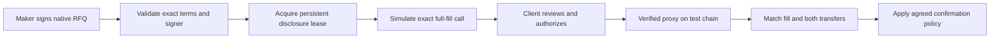

# Authorize exactly what settles.

The proposed production path calls an existing verified 0x native RFQ deployment, with no new OTConChain settlement wrapper. Local test deployments are disposable protocol fixtures. Inspect the actual live proxy, required selector implementations, administration and source/security mapping before selecting a real-asset environment.

## Two parties, separate permissions

The client approves the sell token to the verified proxy. The maker approves its inventory token to that proxy. The maker signs native offer terms. The client signs/sends the fill transaction. These permissions serve different purposes and do not give the OTConChain backend a trading key.



## Exact full requested fill

```typescript
fillOrKillRfqOrder(order, signature, order.takerAmount)

// Expected selector in the pinned implementation: 0x438cdfc5
// from: client EOA
// to: verified Exchange Proxy
// value: 0
```

The pinned entrypoint is nonpayable. Requesting the entire signed takerAmount means this application’s trade fills in full or reverts. The protocol supports other behaviors through other calls; the UI policy is not a new global all-or-nothing constraint on that order.

The direct fill delivers maker output to the caller. Keep the receiving wallet equal to the client wallet in the initial profile. Validate calldata locally; do not trust a maker-supplied arbitrary transaction target or function.

## Preflight checks

- Verify chain, target proxy and active feature identity against trusted configuration.
- Check exact token addresses, decimals and supported token behavior.
- Recover maker signature, verify authorization and match taker/executor.
- Validate base-unit ranges, full sell amount, output minimum, pool and expiry headroom.
- Check balances, allowances, cancellation/fill state and actual external executor.
- Simulate the exact transaction against current state, then present it for client authorization.

Simulation is a current-state check, not a guarantee that a later block will accept the call. A revert undoes token effects within that transaction but not an earlier approval or the gas spent.

## Expiry, cancellation and revocation

Native expiry is an onchain condition. An API withdrawal or an auction cancellation record does not revoke a signed order. Use the protocol’s authorized cancellation operation and observe chain inclusion. Confirm the active implementation’s semantics rather than assuming authority from an offchain contact.

A maker can authorize/revoke an EOA order signer through the protocol. Revocation may invalidate many outstanding quotes. Track the full signed exposure set and agree incident procedures before connection.

## Wallet modes

| Mode | taker | txOrigin | Initial position |
| --- | --- | --- | --- |
| Direct EOA | Client EOA | Same EOA | First integration |
| Safe | Safe address | Actual external executor | Separate testing required |
| Relayed or automated | Actual verified call path | Agreed relayer/origin arrangement | Outside initial scope |

The pinned maker verification path uses EOA signatures rather than arbitrary ERC-1271 signature validation. A contract inventory wallet’s ability to register an EOA must be demonstrated through its actual execution controls.

## Source and review boundary

The local source is pinned to 0x commit 2c8e51e36ccbafa39f7c9003f4087710665acb02. See the [native settlement implementation](https://github.com/0xProject/protocol/blob/2c8e51e36ccbafa39f7c9003f4087710665acb02/contracts/zero-ex/contracts/src/features/native_orders/NativeOrdersSettlement.sol) and [official function reference](https://docs.0xprotocol.org/en/latest/basics/functions.html).

Upstream reports cover specific scope and revisions. They do not certify our adapter, authentication, wallet UI, local compilation or a selected deployed proxy. Real-asset activation needs deployment evidence, supported-token tests and explicit participant acceptance.
