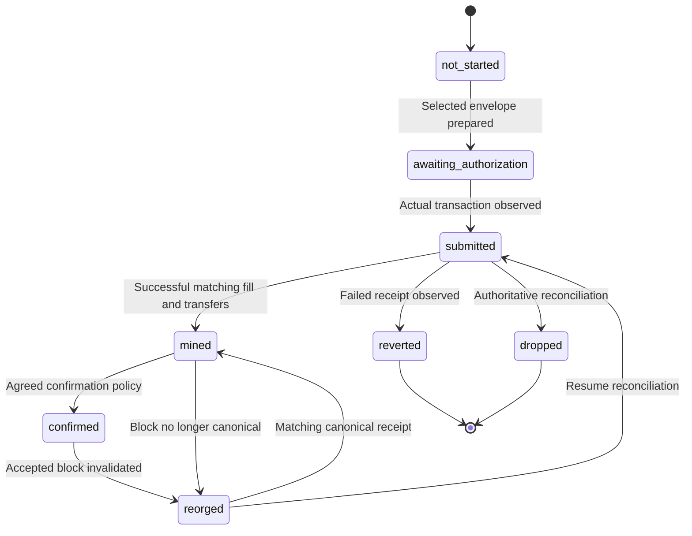

# A trade record you can follow.

Execution evidence links the request and selection to the transaction actually observed. The report must distinguish business approval, prepared calldata, submitted transaction, mined receipt and the eventual confirmation decision.

## Explore the evidence structure

## Records and identifiers

| Record | Required fields |
| --- | --- |
| Auction | auctionId, clientId, request version, exact terms, invited-maker set, opensAt/closesAt, ranking version and status |
| Quote | quoteId, requestId, makerId, full response, orderHash, receivedAt, validatedAt and superseded-quote link |
| Approval | Selected quoteId/orderHash, approver wallet, approved transaction digest and timestamp, actual evidence for the chosen wallet mode |
| Execution | chainId, transactionHash, blockNumber, blockHash, state, confirmation count, decoded native fill and observed transfers |
| Evidence package | schemaVersion, explicit mode, linked records, optional benchmark, assumptions and integrity hash |

Enforce uniqueness, relationships and organization/role scoping. The business IDs are offchain; native orderHash is the cryptographic settlement link. A stored approval row alone does not prove a cryptographic or policy approval.

## Reconcile actual settlement

Match the expected proxy, exact orderHash, maker, taker, token addresses and filled amounts. Decode the native RfqOrderFilled event and both token transfers. Check actual supported-token balance effects where relevant; an unrelated event or wrong-contract log is not evidence of this trade.

Client sell token moves to the maker, and maker buy token moves to the client, within one successful native fill. Retain the receipt, block hash and observed transfers. Do not produce a settled report when only calldata or a synthetic receipt exists.

## Finality and failure

Submitted is not mined, and mined is not the same as final under your chain policy. Transactions can remain pending, be replaced or be dropped. Reverts are a separate outcome. If a reorg changes the receipt/block relationship, reopen reconciliation and restore the appropriate pending state.

Agree chain-specific confirmation thresholds and exceptional reorg handling for the actual environment. The local fixture has no production finality policy. An order’s expiry does not establish the outcome of a previously submitted transaction; inspect the chain.

## Integrity, benchmarks and privacy

An evidence hash is a deterministic digest of canonical retained data. It detects changes against that digest; it is not an independent timestamp, a completeness proof, a legal certification or proof of best execution.

Benchmarks must record source, sampledAt, comparable sell amount, whether executable, estimated output and fee assumptions. Do not present CoinGecko midpoint or a modeled public route as realized savings.

Store losing quotes and business documents privately with explicit role access. Publish no institution’s RFQ history as a marketing feed. Before operational activation, agree data retention, export, incident handling and participant access. The local onboarding preview uses a separate initial application policy described in the application form.
