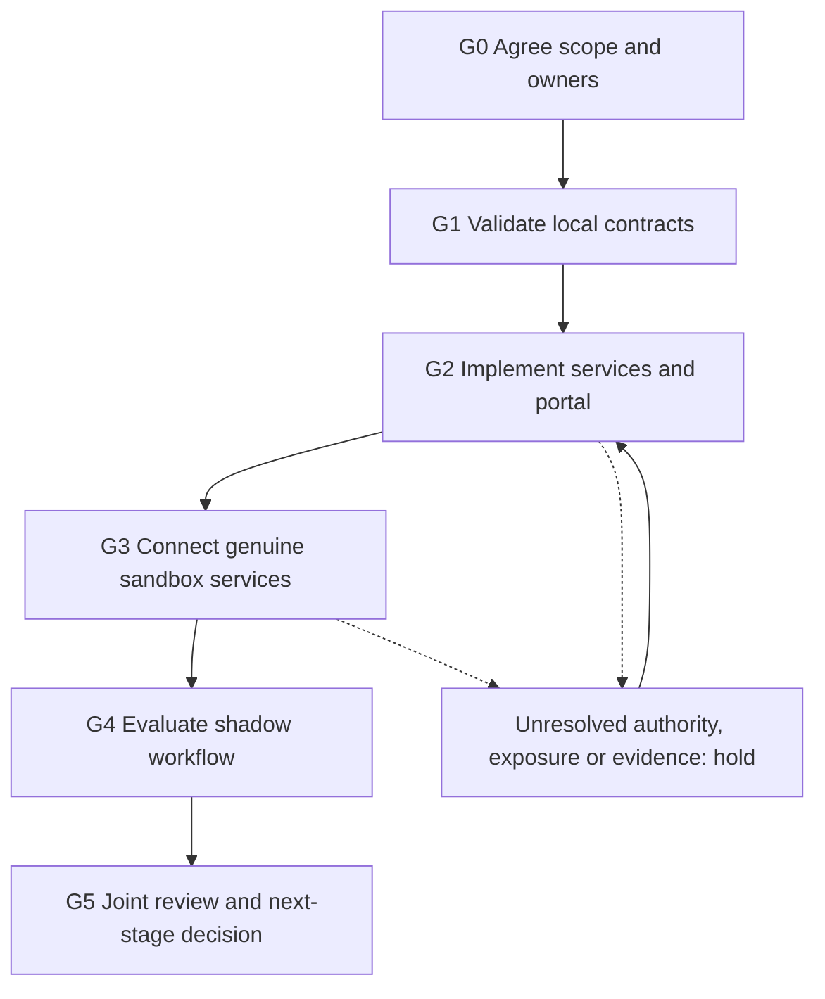

# Delivery roadmap

[← Repository guide](../README.md) · [Scope](01-pilot-scope.md) · [Connection day →](09-connection-and-acceptance.md)

Build one vertical slice: terminal request → authentic desk response → client approval → reconciled test-chain outcome. The target terminal must confirm its extension and backend capabilities; a widget layout or exchange connector alone does not provide this RFQ path.

## Gate map

| Gate | Deliverable | Exit evidence |
| --- | --- | --- |
| G0 · Agree | Named roles, entity/desk authority, one chain/pair, direct EOA, limits, consent and cost treatment | Versioned scope and privately completed environment sheet |
| G1 · Exercise locally | Schema validation, dry-run client, loopback maker, signature and calldata checks | Reproducible test output pinned to a repository commit |
| G2 · Implement | Persistent coordinator, secure client portal, terminal connector, maker transport and reconciler | Deployed release/config pins plus integration/failure tests |
| G3 · Joint sandbox | Actual terminal and desk services, funded test wallets and verified test deployment | Every applicable acceptance case has evidence and named reviewers |
| G4 · Shadow evaluation | Consenting participants; realistic request flow with execution disabled | Agreed sample, outcome/error/latency records and desk feedback |
| G5 · Review | Defects, integration effort, workflow quality and commercial fit | Joint decision: iterate, stop or define a separate next-stage scope |

G1 is available in this repository. G0 and later joint gates remain open until both teams record approval. No dates or response SLA are assumed.

## Parallel work packages after G0

| ID | Owner | Implementation | Depends on | Done when |
| --- | --- | --- | --- | --- |
| W1 | OTConChain backend | Scoped identities, organization mapping, immutable request store, durable idempotency and capabilities | G0 | Changed retries conflict; cross-tenant reads do not disclose resources |
| W2 | Terminal team | RFQ entry action, exact account/context mapping, authenticated backend calls, one-use POST handoff and polling | W1 contract | Reconnect resolves the same request; credentials never enter browser code |
| W3 | Maker desk | Quote endpoint, native signing, test inventory/allowance, exposure tracking and cancellation | Approved native environment | Genuine signed desk response and negative cases validate |
| W4 | OTConChain portal | Sign-in, organization/wallet checks, explicit selection, disclosure lease and exact transaction review | W1, W3 | Repeated preparation returns the same lease; another quote cannot leak while exposure is unresolved |
| W5 | OTConChain chain operations | Preflight, supported-token simulation, transaction/replacement tracking, fill/transfer reconciliation and receipt revisions | W3, W4 | Mined, confirmed, revert and reorg states match observed chain evidence |
| W6 | Joint operations | Limits, consent/disclosure, stop procedure, incident contacts, retention/export and acceptance records | W1–W5 | Owners complete connection-day and recovery evidence |

## Terminal adaptation checklist

Translate an exchange symbol into approved chain/token addresses and decimals. Do not carry a spot/futures selector, exchange balance or terminal admin role into wallet authority. Add the RFQ entry point only after the terminal team agrees how it is installed and maintained.

The first version needs a backend that can create a scoped request, issue an allowed handoff and poll status. It does not require a bot runtime, third-party scripts, embedded wallet trading or automated hedging. Those capabilities require separate design and acceptance.

## Proposed evaluation

Agree at least 20 replay/shadow requests across the chosen size bands, or replace that target jointly. Record mode, source and outcome for each. Compare genuine quote/decline latency, completion, desk effort and recovery quality. Keep modeled benchmarks separate from realized fills and costs.

## Definition of pilot completion

- [ ] Agreed scope and filled private environment pin the actual services and test deployment.
- [ ] All applicable cases in [the matrix](../acceptance/matrix.json) pass, or exceptions have explicit joint owners and acceptance.
- [ ] A real terminal request and genuine desk response link to the same client decision and reconciled result.
- [ ] Shadow mode releases no executable payload or trading approval.
- [ ] Unknown exposure and failed/reorged outcomes have tested recovery paths.
- [ ] Both technical owners review the evidence and record the next-stage decision.

A future multi-maker experiment needs independent eligible desks and tested bid isolation. Any real-asset phase needs its own agreement and activation evidence.
