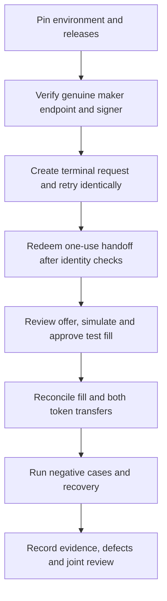
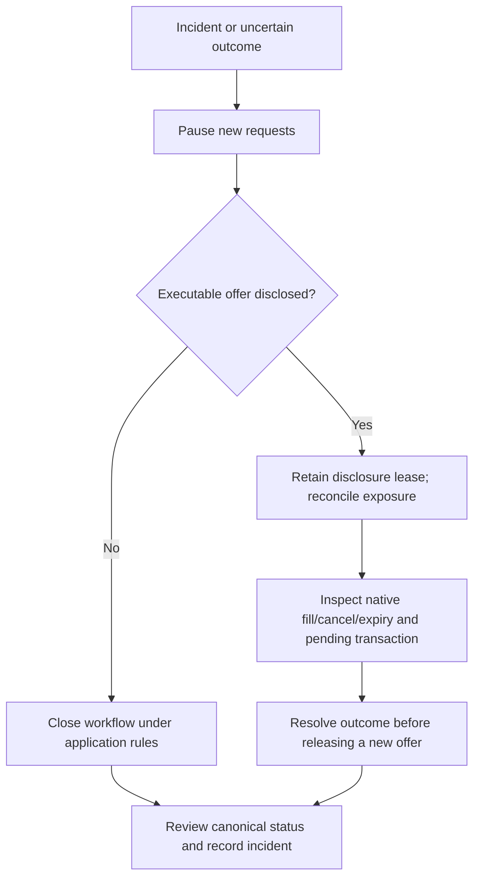

# Connection day and acceptance

[← Roadmap](08-delivery-roadmap.md) · [Environment template](../config/pilot-environment.example.json) · [26-case matrix](../acceptance/matrix.json)

## Prepare the environment privately

Copy the example environment to a private working record. Leave no credentials in that file. Record release/commit pins, base URLs, allowed origins and return targets; chain/proxy verification; token addresses and decimals; public maker inventory/signer and client EOA addresses; limits, deadlines and confirmation policy; named reviewers and incident owners.

The fields in `proposedTimingOnly` are discussion defaults: a 60s handoff ticket, 60s replay tolerance, 24h idempotency retention and 2s polling floor. They do not activate configuration. Fill and approve `agreedTiming` independently of quote expiry and human-review headroom.

## Connection sequence

| Step | Operator action | Evidence to retain |
| --- | --- | --- |
| 1 | Compare actual release and completed environment; reject placeholders | Commit/release IDs and environment version |
| 2 | Verify desk transport, signer authorization, balance, allowance and validity | Redacted genuine response, public addresses and verification result |
| 3 | Create from the real terminal; retry with identical key/body | Same request ID and correlation; changed replay returns 409 |
| 4 | Submit handoff via top-level POST; verify organization and EOA before disclosure | One-use/expiry/isolation test results; never store the ticket in public evidence |
| 5 | Select, acquire one disclosure lease, review and simulate exact full fill | Selected quote/order hash, request version and client decision |
| 6 | Observe the test chain and retrieve the receipt through the partner API | Actual transaction/block references, native fill, both transfers and confirmation policy |
| 7 | Exercise failure, replacement/reorg and reconnect paths | Stable case IDs, redacted traces and canonical receipt revisions |
| 8 | Review results together | Case status, evidence references, defect owners, reviewers and scoped next decision |

## Acceptance groups

| Group | Minimum questions |
| --- | --- |
| Identity and transport | Are scope, tenant isolation, replay and rate limits enforced? |
| Request integrity | Do identical retries recover and changed terms conflict? |
| Desk response | Are real signatures, domain, expiry, authority and exact amounts checked? |
| Client control | Can only the enrolled organization/EOA obtain and authorize its offer? |
| Exposure | Does cancellation after disclosure require reconciliation? |
| Chain result | Are revert, pending, replacement, confirmations and reorg distinguished? |
| Evidence | Can both services resolve the same versioned selected-trade outcome? |
| Shadow / affiliation | Is execution disabled, with single-maker affiliation disclosed? |

Every case in the JSON matrix starts **unrun**. The local tests validate fixtures and primitives; they do not complete that matrix. Store actual client/desk evidence privately and put only redacted synthetic examples in this repository.

## Stop and recover

Revoking a service credential prevents further API use; it does not cancel a native signed offer or pending transaction. A terminal Stop action must follow the RFQ lifecycle. An unresolved pending result never triggers an automatic replacement economic trade or public-market fallback.

## Before using the client against an external service

The reference client reads `examples/partner.json` and is dry-run by default. Do not send its mock identities as a real request. After both teams approve the actual sandbox, supply a separate reviewed fixture copy or adapt the client to that approved configuration, deliver its scoped token server-side and opt into `--send` explicitly. The scaffold only creates a request after checking capabilities; it is not a complete terminal connector.
